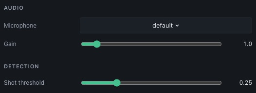

# Audio setup

## Select and tune the microphone

Open **Preferences** and select **Microphone** in the **Audio** section. Adjust
**Gain** and configure **Shot threshold** in **Detection**. Save your changes.
Set **Refractory** under **Session settings** on the target page before
recording. This interval prevents repeated registration of one sound event.

<figure markdown="span">
  { width="526" height="192" }
</figure>

## Test shot detection

Check that a deliberate shot sound registers once and that ordinary background
noise does not register. Raise the threshold if unrelated sounds trigger shots.
Lower it or increase gain if shots are missed. Recheck after changing microphone
position or the room environment.

## Trace timing around each shot

The session’s **Pre-shot**, **Post-shot** and **Release window** settings
control the trace intervals used for shot review. Camera and audio measurements
share a monotonic time base in the controller.

## Hardware limits

Real microphone input requires the desktop application with system backends.
Synthetic devices and the browser mock cannot verify microphone sensitivity,
latency or permissions on your machine.
