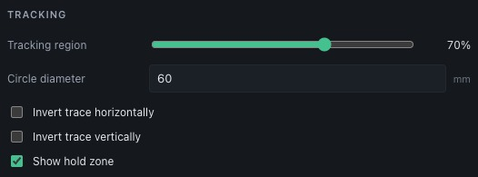

# Tracking and the printed circle

ShotTrainer uses a known circle diameter to convert camera measurements into
real-world millimetres.

Unlike many target-tracking systems, there is no separate calibration procedure.
The scale is calculated continuously from the detected size of the tracking
circle, so every frame effectively calibrates itself.

The tracking circle diameter is configured in:

**Preferences > Tracking > Circle diameter**

Measure the finished printed mark and enter its diameter. The current interface
prints shot results but does not generate a tracking marker.

## How scaling works

The camera is mounted to the rifle and points towards the target.

For each frame, ShotTrainer detects the tracking circle and measures:

- The circle centre in image pixels
- The circle radius in image pixels

The centre of the camera image represents the current pointing direction of the
rifle.

The difference between the image centre and the detected circle centre gives the
rifle's offset from the target centre.

To convert that offset into millimetres, ShotTrainer calculates a scale factor
using the known diameter of the tracking circle:

```text
mm per pixel =
tracking circle diameter (mm)
÷
detected circle diameter (pixels)
```

The tracker smooths the measured centre and circle axes before converting
positions. For a circular detection the formula above applies to its radius.
For an elliptical detection, scaling follows its major and minor axes and
orientation. The scale updates as the apparent size changes.

For example:

- Moving the camera closer makes the circle appear larger.
- Moving the camera further away makes the circle appear smaller.

In both cases, ShotTrainer automatically adjusts the scale calculation to
compensate.

## Setup workflow

Prepare a dark circular mark on a light background, or use the aiming mark on a
competition target. Print at actual size and measure the finished diameter.
Mount it flat at the target location, then enter its measured diameter in
**Preferences > Tracking > Circle diameter**.

<figure markdown="span">
  { width="526" height="195" }
</figure>

Check that the complete mark remains visible within the tracking region during
normal aiming movement. Tracking updates the scale as the detected apparent size
changes. An incorrect configured diameter scales all millimetre offsets
incorrectly.

The interface has no tracking-marker generator or zero-setting controls.
Stored zero offsets can be reflected in the camera overlay.

See [printing and target preparation](printing-targets.md) and
[accuracy](accuracy.md) for practical limitations.
