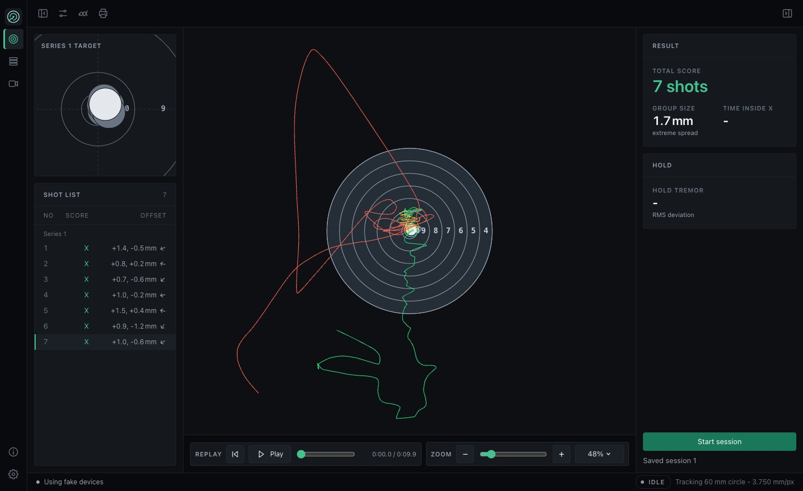
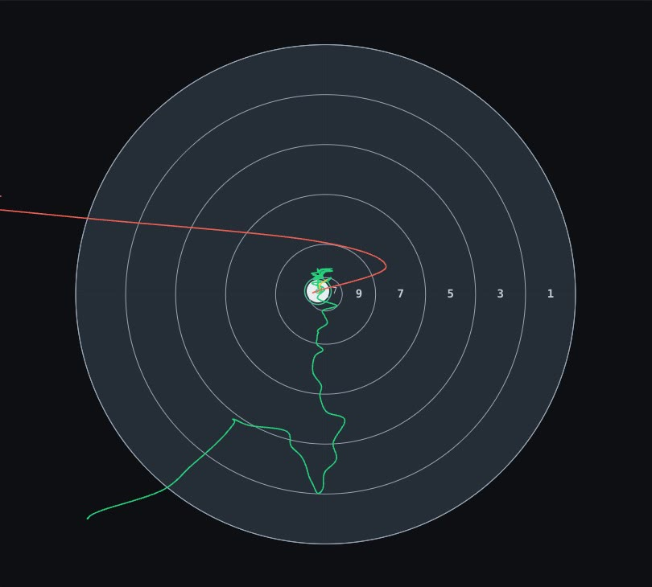

<section class="st-intro" aria-labelledby="intro-title">
  <h1 id="intro-title">
    ShotTrainer
    
      Camera-based aim tracking and shot analysis for shooting practice.
    
  </h1>
  

    A camera mounted on your rifle tracks a printed black circle. A microphone
    detects each shot, so you can review your hold, estimated shot position
    and follow-through, then save the session for later analysis.
  

  

    Free and open source. Runs on Windows, macOS and Linux. Sessions stay on
    your computer, with no account or subscription.
  

  

    <a class="st-button" href="installation/">Install ShotTrainer</a>
    <a href="getting-started/">Read the getting started guide</a>
  

</section>

<figure class="st-product-image">
  
  <figcaption>
    Reviewing a shot on the default target face. The session overview keeps
    the full group visible while the centre view shows the selected trace.
    Demonstration data in the current interface. Select the image to enlarge it.
  </figcaption>
</figure>

<section class="st-guides" aria-labelledby="guides-title">
  <h2 id="guides-title">Documentation</h2>
  <dl class="st-guide-list">
    

      <dt><a href="installation/">Installation</a></dt>
      <dd>Download a package for your operating system or run from source.</dd>
    

    

      <dt><a href="cameras/">Cameras and lenses</a></dt>
      <dd>Camera reports, lens choices and target framing.</dd>
    

    

      <dt><a href="setup/">Mounting and alignment</a></dt>
      <dd>Position the camera, set the circle diameter and zero the trace.</dd>
    

    

      <dt><a href="sessions/">Recording sessions</a></dt>
      <dd>Record practice, sighters or a match.</dd>
    

    

      <dt><a href="replay/">Shot replay</a></dt>
      <dd>Select a shot and inspect its trace with the playback controls.</dd>
    

    

      <dt><a href="troubleshooting/">Troubleshooting</a></dt>
      <dd>Resolve camera, tracking and shot detection problems.</dd>
    

  </dl>
  

    For saved sessions, see the <a href="session-browser/">session browser</a>.
    The <a href="stats/">statistics guide</a> covers group size and hold analysis.
  

</section>

<section class="st-setup" aria-labelledby="setup-title">
  <h2 id="setup-title">Before your first session</h2>
  
You will need:

  <ul>
    <li>A camera with a lens that keeps the tracking circle clearly in focus
      at your shooting distance, and a rigid mount on the rifle.</li>
    <li>A microphone near the firing point for shot detection.</li>
    <li>A printed target with a black circular aiming mark, or a
      <a href="printing-targets/">marker sheet</a> of known diameter.</li>
  </ul>
  

    Camera suitability depends on distance, lens choice, lighting and the
    number of pixels across the circle. Read
    <a href="accuracy/">tracking accuracy and limitations</a> before choosing
    your equipment. Shot positions are estimated from the aim trace at audio
    detection. Scores are based on those positions rather than measured
    bullet holes.
  

  <ol class="st-setup-list">
    <li>Mount and align the camera so the circle stays in view as you aim.</li>
    <li>Set the <strong>tracking circle diameter</strong> to match the printed
      circle. This is the measurement used to convert pixels into millimetres.</li>
    <li>Select the <strong>target face</strong> for scoring, then hold on the
      target centre and use <strong>Zero on aim</strong>.</li>
    <li>Adjust <a href="audio-setup/">microphone sensitivity</a>, check that a
      shot is detected, then start a session to record your practice.</li>
  </ol>
  
Follow the <a href="setup/">full setup guide</a> for alignment and checks.

</section>

<section class="st-replay" aria-labelledby="replay-title">
  <h2 id="replay-title">Inspect a shot trace</h2>
  

    Select a shot in the session overview or history to replay the recorded
    aim movement before and after it. Collapse either side pane to give the
    trace more space.
  

  

    <figure>
      <video controls muted playsinline preload="none"
        poster="assets/img/app.jpg" width="1440" height="880"
        aria-label="Replay demonstration in the current ShotTrainer interface">
        <source src="assets/img/replay_shot.mp4" type="video/mp4">
        <a href="assets/img/replay_shot.mp4">Download the replay demonstration</a>.
      </video>
      <figcaption>
        A 10-second replay using demonstration data. Use the video controls
        to play or pause.
      </figcaption>
    </figure>
    <figure>
      
      <figcaption>
        Trace detail. Green shows the approach, yellow the release window and
        red the follow-through. See <a href="replay/">shot replay</a> for
        timing and playback settings.
      </figcaption>
    </figure>
  

</section>

