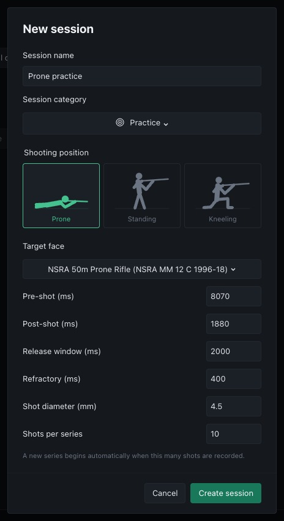
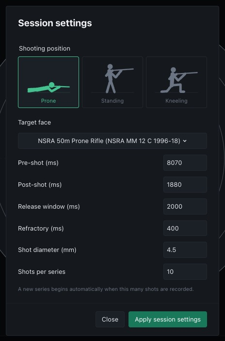
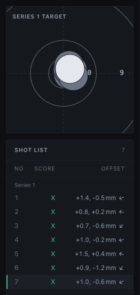
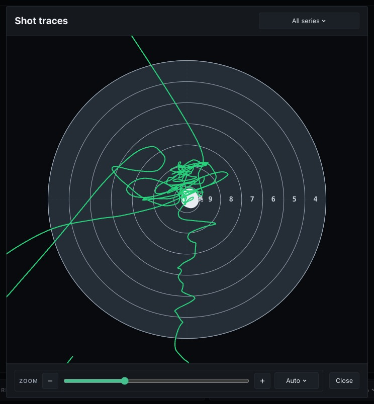

# Recording sessions

## Create a session

Open **Sessions** from the navigation rail and select **New session**. Enter a
name and select Practice, Sighter or Match. Choose the target face, shooting
position, shot diameter, pre-shot and post-shot windows, release window,
refractory interval and shots per series. **Create session** prepares these
settings and returns to the target page. **Cancel** leaves the current session
unchanged.

<figure markdown="span">
  { width="464" height="852" }
</figure>

## Start and stop recording

The session controls and current session status sit at the bottom of the right
sidebar. Select **Start session** to begin recording and **Stop session** to
finish. From an idle target page, Start session uses the prepared settings and
name, or the defaults if no session has been prepared. When reviewing a saved
session, this control shows **New session** and opens the creation dialogue.

## Session settings

**Session settings** opens from the button at the top left of the target page,
next to the shots pane toggle. The settings can be changed only while idle with no
shots. Select **Apply session settings** to use the edited values. Create a new
session to change settings after recording or while reviewing. The settings are
stored with the session and restored when it is opened.

<figure markdown="span">
  { width="464" height="701" }
</figure>

## Series and the shot list

Shots are grouped into series of the configured size. New sessions default to
10 shots per series. The next series starts automatically as shots are recorded.
Selecting a shot also selects its series in the compact overview.

Shots appear in the shot list with their score and offset. Selecting a shot
loads its saved trace window for review. Use [replay](replay.md) to inspect
movement before and after the shot.

<figure markdown="span">
  { width="280" height="590" }
</figure>

## Saved sessions

Sessions are stored in a local SQLite database. Open **Sessions** from the
navigation rail to find previous sessions, rename them, change categories,
delete them or export their data. See [session browser](session-browser.md).
Stop recording before deleting the active session. Synthetic desktop sessions
use a separate temporary data directory.

## Print results and overlay traces

Select the muted **Print shot sheet** icon beside the target controls on the
main page to print the results. Printing includes all shots, scores and offsets.

Select **Overlay shot traces**, beside the print icon, to draw the trace window of
every shot on one target. The drop-down chooses all series or a single series.

<figure markdown="span">
  { width="744" height="804" }
</figure>

## Review recorded shots

Review recorded shots with [shot replay](replay.md) and
[shot statistics](stats.md), or browse earlier work in the
[session browser](session-browser.md).
