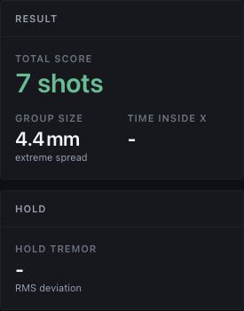

# Shot statistics

## Sidebar figures

The right sidebar shows total score, group size, the percentage of trace
samples inside the innermost scoring ring, and hold tremor. Without scored
shots, the total figure shows the shot count. Missing tracking samples can
leave measurements unavailable.

<figure markdown="span">
  { width="300" height="500" }
</figure>

## Group size and hold tremor

**Group size** is the largest distance between any two positioned shots, shown
in millimetres. Its tooltip also gives mean radius from the group centre.
**Hold tremor** is the RMS deviation of the selected shot’s pre-shot trace from
its mean position. **Time inside** counts the plotted trace samples within the
innermost ring. It is a sample percentage rather than a duration in seconds.

## Hold figures for the selected shot

The Hold panel also shows five figures for the selected shot. Figures that meet
their target are green and those that miss are amber.

- **Aiming time** is the time from the last entry into the outermost scoring
  ring to the shot. The target is under 13 s. The trace is read back 30 s
  from the shot, so longer holds show as a lower bound.
- **Steady in 10** is the share of the last second before the shot spent inside
  the ten ring. The target is 90% or more.
- **Steady on average** is the share of the last second spent within a ten-ring
  sized circle around the mean aim point of that second. The target is 90% or
  more.
- **Steady in** a custom ring is the same measure for the diameter set under
  [Custom hold ring](preferences.md#custom-hold-ring). It has no target and is
  hidden when the preference is 0.
- **Shot offset** is the distance from the mean aim point of the last second to
  the shot position. The target is under 3 mm.

These figures are blank when the face has no ten ring or the trace has no
positioned samples in the window.

## What these measurements show

Group measurements describe the recorded shot positions. Hold measurements
describe aim movement around a selected shot. They do not measure actual
projectile impact or replace a measured paper group.

Use [replay](replay.md) to interpret a trace alongside its numbers. See
[accuracy](accuracy.md) for limitations and [scoring](scoring.md) for scoring
rules.
